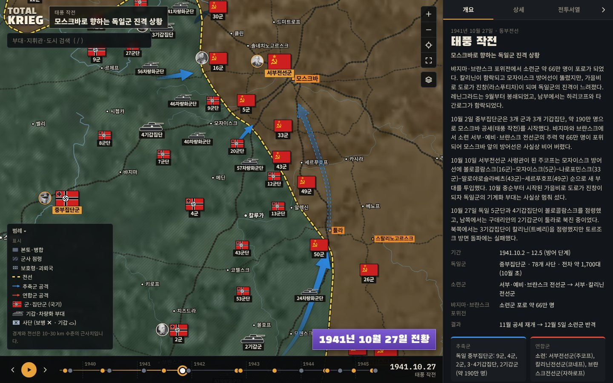

# total-krieg

Fight for country — **Total Krieg 작전지도**: 1939–1945 유럽 전역의 영토 변화와 전투서열(집단군·군·군단·사단), 지휘관을 한 장의 지도에서 보는 인터랙티브 전황도입니다.



## 무엇을 볼 수 있나

- **영토 변화 18개 시점** (1939.9.1 폴란드 침공 → 1945.5.8 유럽 전승일). 국가별 지배 세력, 병합·군사 점령·괴뢰국 구분(빗금·점 무늬), 교전국 사이의 전선(노란 점선)이 시점마다 바뀝니다. 연표의 ▶ 버튼으로 자동 재생합니다.
- **11개 작전의 전투서열**: 백색(폴란드), 황색(프랑스), 바르바로사, 태풍(모스크바), 엘 알라메인, 천왕성(스탈린그라드), 쿠르스크, 노르망디, 바그라티온, 아르덴, 베를린. 부대 494개.
  - 집단군·전선군과 군은 해당 국가의 당시 국기로, 기갑집단·기갑군단·전차군은 전차 실루엣으로, 사단은 NATO식 병과 기호로 표시합니다.
  - 확대할수록 군 → 군단 → 사단이 차례로 나타나고, 겹치는 표식은 상위 제대를 우선해 자동으로 정리됩니다.
  - 공격 방향 화살표(추축군 파랑, 소련군 빨강, 서방 연합군 주황, 계획은 점선).
- **지휘관 363명**: 한국어 이름·생몰년·짧은 소개와 위키미디어 공용의 사진(저작자·라이선스 표기). 부대를 누르면 지휘 계통, 예하 부대, 지휘관 카드가 나옵니다. 검색으로 인물을 찾으면 그 사람이 지도에 등장하는 모든 지휘를 볼 수 있습니다.
- **국가 정보**: 지역을 누르면 그 땅의 전쟁 전 국가, 현재 지배 세력과 상태, 지도자, 영토·정세 변화 연표, 지배 면적을 보여줍니다.
- 팬·줌(휠, 드래그, 핀치), 검색(`/`), 키보드(← → 시점 이동, Esc 선택 해제), 레이어 켜기/끄기, 휴대폰 화면 지원.
- 독일군 표기를 당시 군기 대신 발칸크로이츠로 바꾸는 옵션이 있습니다(레이어 메뉴).

## 실행

```bash
npm install
npm run dev          # http://localhost:5173
npm run build        # dist/ 정적 사이트
npx vite build --mode single   # JS·CSS를 index.html에 인라인한 단일 페이지 빌드
```

주소 해시로 작전을 바로 열 수 있습니다: `#typhoon`, `#kursk`, `#overlord`, … 또는 `#d1944-09-15`처럼 날짜.

## 구조

```
src/
  map/            캔버스 지도 렌더러, d3-zoom, 부대 SVG 오버레이, 화살표
  components/     패널(개요·상세·전투서열), 연표, 검색, 범례, 국기 SVG
  data/
    scenarios/    작전별 부대 배치·화살표·해설 (TypeScript)
    timeline.ts   18개 시점의 제목·요약
    countries.ts  국가 정보
    people.json   지휘관 (scripts/data/people.txt에서 생성)
    places.json   도시·지명 좌표 (scripts/data/places.txt에서 생성)
public/
  data/           base.topo.json(지형), territories.topo.json(영토), relief.json
  img/relief.webp 음영기복 지형 이미지 (람베르트 정각원추 도법으로 재투영)
  portraits/      지휘관 사진 240×300
scripts/          데이터 빌드 파이프라인 (Python + Node)
```

## 데이터 다시 만들기

원본 데이터는 `.cache/src/`에 받습니다(약 260 MB, git 제외).

```bash
pip install shapely numpy pillow
# 원본: Natural Earth 10m(land, lakes, rivers, railroads, admin 0/1), NE1_50M_SR_W 래스터,
#       CShapes 2.0 GeoJSON, GeoNames cities1000 → .cache/src/
npm run data:base        # 육지·호수·하천·철도 → public/data/base.topo.json
npm run data:relief      # 지형 래스터 재투영 → public/img/relief.webp
npm run data:places      # 지명 → src/data/places.json
npm run data:territory   # 영토 18개 시점 → public/data/territories.topo.json
python3 scripts/build_people.py
npm run data:portraits   # 위키백과·위키데이터에서 지휘관 사진 (요청 간격 제한 있음)
```

영토 계산: 1939년 8월 31일 국경(CShapes)을 수데텐란트·단치히·폴란드 분할선·비시 경계선·유고슬라비아 분할 등으로 잘게 나눈 뒤(`scripts/territory/pieces.py`), 시점별 정치 상태(`politics.py`)와 손으로 그린 전선(`fronts.py`)을 적용합니다. 전선은 교전 세력 영역의 공유 경계로 자동 계산됩니다.

## 정확도

- 전선과 점령 경계는 10–30 km 수준의 근사치입니다. 소규모 포위망·교두보는 일부만 반영했습니다.
- 부대 위치는 해당 날짜의 대략적인 작전 구역(사령부 또는 전선 구간)입니다.
- 지휘관은 해당 날짜에 실제로 지휘한 인물을 기준으로 했습니다(예: 1941.10.27 제43군은 아키모프, 10.29부터 골루베프).

## 출처와 라이선스

| 자료 | 용도 | 라이선스 |
|---|---|---|
| [CShapes 2.0](https://icr.ethz.ch/data/cshapes/) (Schvitz et al. 2022) | 1939년 국경 | CC BY-NC-SA 4.0 — **비영리 이용만 가능** |
| [Natural Earth](https://www.naturalearthdata.com/) | 육지·하천·호수·철도·행정구역, 음영기복 래스터 | 퍼블릭 도메인 |
| [GeoNames](https://www.geonames.org/) | 지명 좌표 | CC BY 4.0 |
| [Wikimedia Commons](https://commons.wikimedia.org/) | 지휘관 사진 | 사진마다 다름(분데스아르히프 CC BY-SA 3.0 DE, 퍼블릭 도메인 등) — `src/data/portraits.json`과 앱 안에 저작자·라이선스 표기 |
| 위키백과 각 작전·전투서열 문서 | 전투서열, 지휘관 확인 | 각 작전 패널의 참고 자료에 링크 |

CShapes에서 파생된 `public/data/territories.topo.json`은 CC BY-NC-SA 4.0을 따릅니다. 상업적으로 쓰려면 이 파일을 다른 국경 데이터로 다시 만들어야 합니다.

나치 독일의 군기는 역사 교육·고증 목적으로만 표시합니다.
